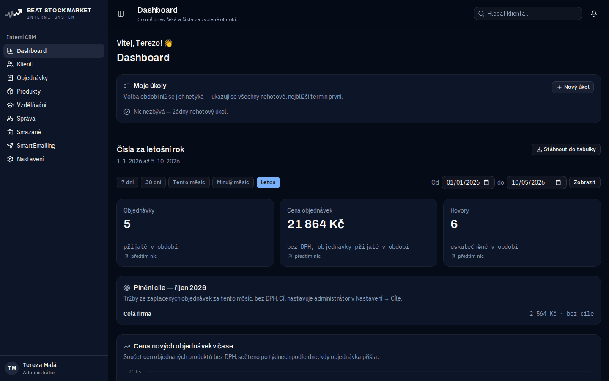
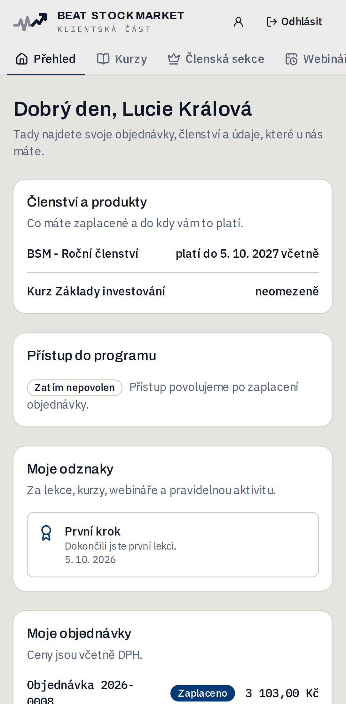
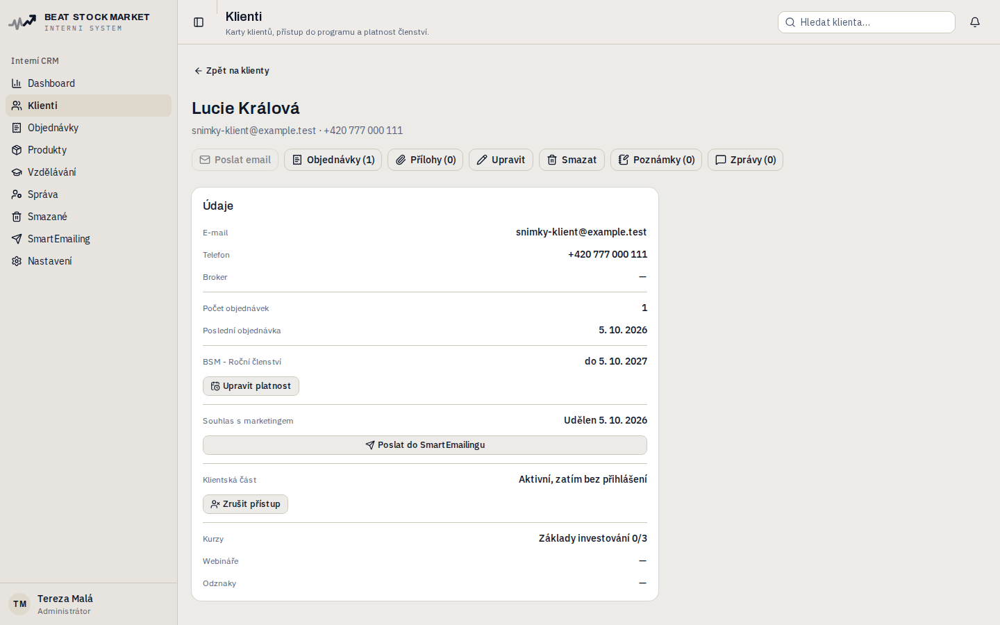
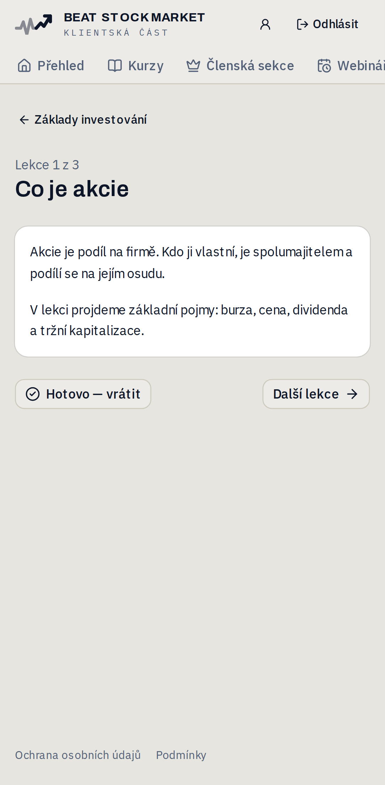
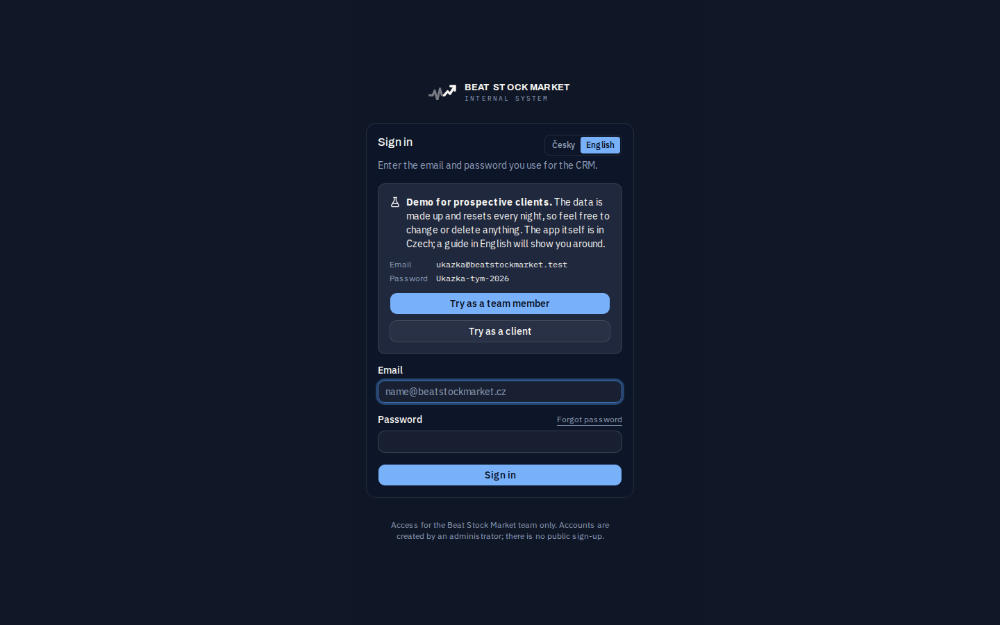
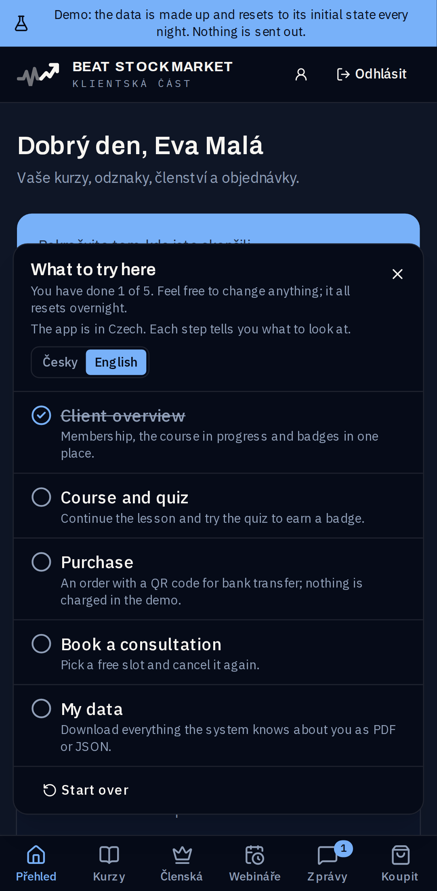

# CRM Beat Stock Market

**CRM a klientská aplikace pro firmu, která prodává investiční vzdělávání.**
Objednávky chodí z webu, tým je vyřizuje v CRM a klienti mají vlastní
aplikaci v telefonu s kurzy, členskou sekcí a oznámeními.

**Vyzkoušejte si to:** [živá ukázka CRM](https://crm-beatstockmarket-dev.up.railway.app/prihlaseni) · [Landing Page napojená na CRM](https://landing-page.jakubkostan.workers.dev/) · [její kód](https://github.com/drakancz/beat-stock-market-landing-page)

Next.js 16 · React 19 · TypeScript · PostgreSQL · Prisma · Playwright · Docker

| CRM pro tým                                     | Klientská aplikace na telefonu                    |
| ----------------------------------------------- | ------------------------------------------------- |
|          |  |
|  |      |
|  |  |

> **In English:** A production CRM and client-facing PWA for a company
> selling investment education — orders from the website, team workflow,
> memberships, courses with badges and push notifications. Next.js 16,
> React 19, TypeScript, PostgreSQL/Prisma, 320+ Playwright tests (570 runs
> across three browsers) in GitHub Actions against the production build,
> deployed on Railway, with a built-in demo mode for visitors — sign-in,
> demo banner and a guided tour are available in English. **The code was written by AI
> (Claude Code) under my direction** — I owned requirements, permissions,
> security rules, review, testing and operations. The rest of this README
> is in Czech, like the code comments.

---

## Co aplikace umí

**Pro tým (CRM)**

- **Objednávky z webu** přes zabezpečené API — cenu bere CRM z ceníku,
  nikdy z požadavku. Číslo objednávky `RRRR-NNNN` přiděluje databáze.
- **Klienti** s hledáním bez diakritiky, poznámkami, přílohami,
  hledáním duplicit a sloučením karet.
- **Platnost členství** se počítá z plateb a navazuje; konec členství
  klientovi ohlásí oznámení týden předem a v den konce.
- **Dashboard** s tržbami, cílem, konverzním trychtýřem a čísly členství
  (aktivní členové, prodloužení, odchody).
- **Slevové kódy** (procenta i částka, platnost, počet použití, jen vybrané
  produkty, jednou na klienta) — slevu počítá vždy server, web posílá jen kód.
- **Doporučení s odměnou:** doporučitel má vlastní kód, CRM pozná nového
  přivedeného klienta a z jeho první zaplacené objednávky spočítá odměnu;
  vyplacená odměna se při vrácení platby nesmaže.
- **Štítky, uložené filtry a hromadné akce** v seznamu klientů, včetně
  filtru „platí, ale nechodí“ (člen, který dlouho nebyl v klientské části).
- **Časová osa klienta** — objednávky, platby, práce týmu, aktivita
  v klientské části a změny z auditního logu v jednom proudu, s filtrem
  podle druhu a načítáním po stránkách; auditní změny vidí jen
  administrátor (hlídá to server i při přímém volání akce).
- **Rychlý náhled klienta** z boku seznamu — údaje, platnost, poslední
  objednávky a dění, šipkami na dalšího klienta.
- **Vlastní pole u klienta** (text, číslo, datum, ano/ne, výběr), která si
  administrátor přidá sám; tým je vyplňuje a filtruje podle nich.
- **Pravidla „když se stane X, udělej Y“** — například „člen přestal chodit
  → povzbudivá zpráva klientovi“ nebo „zaplatil kurz →
  štítek“ (každý produkt svůj štítek). Každá akce proběhne u klienta jen
  jednou. Administrátor si navíc skládá **vlastní pravidla** z podmínek
  (štítek, vlastní pole, nechodí N dní, koupil produkt, končí členství)
  a akcí (úkol, zpráva, štítek).
- **Dotazy klientů k lekcím** s odpověďmi týmu (soukromé, s upozorněním).
- **Rezervace konzultace** — administrátor vypíše termíny, klient se
  zaplacenou konzultací si jeden vybere, přeloží nebo zruší (nejpozději
  24 hodin předem). Dva klienti stejný termín nedostanou ani při kliknutí
  ve stejnou chvíli; den předem přijde připomínka.
- **Odchozí webhooky** (napojení na Zapier a podobné služby) — podepsané
  zprávy o objednávkách, nových klientech, konzultacích a dokončených
  kurzech, bez e-mailů a telefonů; adresy do vnitřní sítě server odmítne.
- **Platební brána GoPay** — stav i částku platby si server vždy ověří
  přímo u brány, oznámení z venku nevěří; objednávka se pak sama označí
  jako zaplacená.
- **Faktury a dobropisy v PDF a export do účetnictví (Pohoda)** — číslo
  dokladu přiděluje databáze, vystavený doklad se nemění ani nemaže,
  oprava jde jen dobropisem; bez IČO a sídla firmy se doklad nevystaví.
- **Konzultace v Google Kalendáři** — rezervace se zapíše do firemního
  kalendáře servisním účtem, bez e-mailu a telefonu klienta.
- **Automatické připomínky** nezaplacené objednávky a webinářů, spouští
  je denní plánovač.
- **Role a oprávnění** (uživatel / administrátor), auditní log každé
  změny, koš s obnovou smazaných záznamů.
- **Napojení na AI (MCP server):** Claude čte data z CRM a s oprávněním
  zapisuje poznámky a úkoly — bez e-mailů a telefonů klientů.
- **Asistent AI přímo v CRM** — klienti jdou k modelu jen pod přezdívkou.
- **Ukázkový režim pro návštěvníky** — jedním přepínačem se z aplikace
  stane živá ukázka: zkušební účty člena týmu a klienta se známým heslem,
  vymyšlená data, která se každou noc vrátí do výchozího stavu, a průvodce
  „Co si vyzkoušet“. Všechno, co by odešlo ven (e-maily, webhooky,
  kalendář, AI, nahrávání souborů), je vypnuté přímo v místě, kde se
  služba volá, ne skrytím tlačítka; zkušební účty si nezmění heslo ani
  nezamknou ostatní.
- **Vstup do ukázky i v angličtině** — přihlášení, pruh ukázky a průvodce
  mají přepínač Česky / English (volba se pamatuje v cookie), aby si
  ukázku prošel i zahraniční návštěvník; samotná aplikace zůstává česká
  a průvodce u každého kroku řekne, na co se dívat.
- **Úvodní konzultace zdarma z Landing Page** — v ukázce si návštěvník vybere
  volný termín, v CRM vznikne klient z webu a rezervace bez platby.

**Pro klienty**

- Vlastní přihlášení oddělené od týmu, dvoufázové ověření.
- **Aplikace na plochu telefonu (PWA)** s push oznámeními — zaplacení,
  konec členství, zprávy od firmy.
- **Kurzy a lekce** s videem, členská sekce, webináře a **odznaky** za
  vzdělávání.
- **Nákup přímo v aplikaci** — prodloužení členství, kurzy a konzultace,
  převodem s QR platbou nebo přes bránu; se souhlasem s obchodními
  podmínkami, jehož verze a čas se u objednávky ukládají.
- **Doporuč přítele** — klient doporučitel vidí svůj kód, počet
  přivedených (bez jmen) a odměny.
- **Moje údaje ke stažení (GDPR)** — klient si sám stáhne kopii svých
  údajů v PDF k přečtení a v JSON k přenesení jinam; interní poznámky
  týmu do ní nejdou.
- **Kvíz na konci lekce a certifikát v PDF** po dokončení kurzu.
- **Postupné odemykání lekcí** (po dnech od nákupu, k datu, po předchozí
  lekci), **hodnocení lekce** hvězdičkami a **body, úrovně a pořadí** —
  za vzdělávání, nikdy za obchody, pořadí bez jmen ostatních klientů.

## Technologie

| Oblast     | Použité                                                       |
| ---------- | ------------------------------------------------------------- |
| Aplikace   | Next.js 16 (App Router, Server Actions), React 19, TypeScript |
| Vzhled     | Tailwind CSS 4, shadcn/ui (Radix), Recharts                   |
| Data       | PostgreSQL 18, Prisma 7 (migrace, spouštěče v databázi)       |
| Přihlášení | Auth.js 5, bcrypt, TOTP, podepsané cookie pro klienty         |
| Validace   | Zod 4 na každém vstupu ze serveru                             |
| Služby     | Amazon SES, Web Push, S3 / Cloudflare R2, Sentry              |
| Testy      | Playwright — 370+ testů v Chrome, Android a iPhone Safari     |
| CI         | GitHub Actions — celá sada u každého PR, produkční sestavení  |
| Provoz     | Docker, Railway, plánovaná služba (cron)                      |

## Zajímavá technická rozhodnutí

- **Oprávnění jsou v dotazu, ne v zobrazení.** Každý dotaz na klienty jde
  přes jednu funkci, která přidá podmínky viditelnosti i koše. Nepovolaný
  dostane 404, ne „nemáte oprávnění“ — z odpovědi se nedá vyčíst, co
  v systému existuje.
- **Content-Security-Policy s jednorázovým klíčem.** Každé načtení
  stránky dostane nový `nonce`; prohlížeč spustí jen skripty aplikace.
  Hlídá to test, který se pokusí vložit cizí skript.
- **Peníze a čísla řeší databáze.** Číslo objednávky i cena ze chvíle
  nákupu vznikají ve spouštěčích PostgreSQL — platí i pro import a testy
  a pozdější změna ceníku starou objednávku nepřepíše.
- **Sleva přesně na haléř.** Ukládá se cena bez DPH, ale zákazník vidí cenu
  s DPH — a při 21 % nejde každou z nich přesně vyjádřit. Výpočet proto
  vybírá jen přesně uložitelné ceny a zbytek dorovná na jiné položce;
  na chybu přišel test (−500 Kč vycházelo jako −500,01 Kč).
- **Osobní údaje neodcházejí ven.** Hlášení chyb do Sentry projde
  anonymizací (e-maily, telefony, parametry adres) a vlastní kontrola
  v rámci `typecheck` shodí sestavení, když ji někdo rozbije.
- **Odolnost proti zneužití:** omezení pokusů o přihlášení, časově
  konstantní porovnání klíčů, přísné čtení UTF-8 u veřejného API,
  ochrana proti SSRF u adres push oznámení.
- **Testy proti produkčnímu sestavení, ne proti vývojovému serveru.**
  Celá sada běží v GitHub Actions u každého pull requestu, každý prohlížeč
  na vlastním stroji, nad stejným `docker compose` jako doma a s hesly
  vymyšlenými pro každý běh. Hned první běh našel chybu, kterou vývojový
  režim schovával: kontrola hlavičky `Origin` porovnávala s adresou
  požadavku, která je v produkci `0.0.0.0` — nahrávání příloh i hromadný
  export by na serveru vždy skončily 403. Opraveno před nasazením
  (porovnává se s nastavenou veřejnou adresou).
- **Automatika „jen jednou“ bez zámků:** pravidla si dřív, než něco
  udělají, zapíšou řádek s jedinečnou trojicí pravidlo + klient + klíč
  epizody. Souběžné spuštění plánovače se tak nepotká a po návratu klienta
  vznikne nová epizoda samo. Test pravidel přitom odhalil starší chybu:
  podmínka `NOT (návštěva >= hranice)` nad prázdnou návštěvou dala v SQL
  „nevím“ a klient, který ještě nikdy nepřišel, z filtru vypadl.
- **Mazání dat se zkouší nanečisto.** Migrace, která něco maže (zrušené
  hovory, portfolia), se před nasazením pustí na kopii databáze ve stavu
  jako na serveru, s vymyšlenými daty právě toho druhu, a kontroluje se,
  že zmizelo přesně to, co mělo — a nic dalšího.
- **Body se neukládají** — počítají se z hotových lekcí, kvízů a účastí,
  takže nejdou ručně „přikreslit“ a nikdy se nerozejdou se skutečností.
- **Vlastní kontroly kódu:** skript hlídá, že soubory se Server Actions
  vyvážejí jen asynchronní funkce (jinak by akce tiše nefungovala),
  další hlídá zastaralá API.

## Jak to spustit

Potřebuješ jen Docker.

```bash
cp .env.example .env                                  # doplň hesla
docker compose up -d                                  # aplikace na :3000
docker compose run --rm web npm run db:migrate        # tabulky
docker compose run --rm web npm run db:seed           # vymyšlená data
docker compose run --rm web npm run auth:admin        # první administrátor
```

Odchycené e-maily: <http://localhost:8025> (Mailpit).

## Testy a kvalita

```bash
docker compose --profile test run --rm e2e            # celá sada Playwright
docker compose run --rm web npm run typecheck         # typy + vlastní kontroly
docker compose run --rm web npm run lint
```

Testy běží nad vlastní databází, kterou si před během vymažou a naplní,
ve třech prohlížečích najednou. Hlídají oprávnění (kdo co nesmí vidět),
hlavní průchody, zobrazení na telefonu a bezpečnostní hlavičky.

Celá sada se pouští **v GitHub Actions u každého pull requestu**
(`.github/workflows/testy.yml`) proti produkčnímu sestavení — desktop
všechno, Android a iPhone obrazovky pro klienty a rozložení, každý na
vlastním stroji. Pull request s červeným
výsledkem se neslučuje. Doma se pouštějí jen testy, kterých se změna týká.

## Jak projekt vznikal: s AI

**Kód napsala AI — [Claude Code](https://claude.com/claude-code) od
Anthropicu — v dialogu se mnou.** Beat Stock Market je můj vlastní
projekt a CRM jsem vedl od prvního zadání až po provoz na serveru.
Neskrývám to, protože právě tohle je dovednost, kterou chci ukázat:
**dotáhnout s AI skutečnou aplikaci do provozu tak, aby byla bezpečná,
otestovaná a udržovatelná.**

**Co jsem dělal já:**

- **Zadání a priority.** Co aplikace dělá, pro koho a v jakém pořadí —
  plán v sedmi fázích, který se během vývoje měnil podle potřeb firmy
  (třeba přechod od obchodních případů k objednávkám z webu).
- **Oprávnění a pravidla.** U každé nové obrazovky jsem rozhodl, kdo ji
  smí vidět a měnit — AI se musela zeptat, nesměla to domýšlet.
- **Pravidla vývoje**, která AI dodržovala (níž).
- **Kontrola změn** v prohlížeči na počítači i na telefonu,
  hlášení chyb a připomínek (tlačítko navíc, jiné chování, vzhled).
- **Provoz:** nasazení na Railway, hlídání každého nasazení, Sentry,
  zálohy, klíče ke službám — tajné údaje AI nikdy neviděla.

**Pravidla, podle kterých AI pracovala** (zapsaná v [CLAUDE.md](CLAUDE.md), AI je
čte na začátku každé práce):

- **Plán před prací, souhrn po ní** — co se změní, čeho se to dotkne,
  jak se to ověří a co se záměrně nedělá.
- **Testy ke každé funkci** a před ohlášením „hotovo“ projde celá sada;
  když test spadne, opraví se chyba, test se nikdy nevypíná.
- **Jen stabilní verze balíčků**, zafixované, `npm audit` hned.
  Jediná výjimka (Auth.js beta) je vědomě schválená a zapsaná.
- **Všechno běží v Dockeru**, nic se neinstaluje do počítače.
- **Oprávnění se ověřuje na serveru a v dotazu**, mazání má vždy
  potvrzovací okno, nic se z databáze nemaže natrvalo bez koše.
- **Osobní údaje klientů neodcházejí ven** — ani do hlášení chyb, ani do
  AI, ani do logů.
- **Do produkce jen přes pull request** se zelenými testy z GitHub
  Actions a po každém nasazení kontrola logů a stavu serveru.

**V číslech:** 300+ commitů za srpen–listopad 2026, 7 fází, 370+
automatických testů (660+ běhů ve třech prohlížečích).

## Autor

**Ing. Jakub Košťan** — <jakubkostan@gmail.com> · [LinkedIn](https://www.linkedin.com/in/jakubkostan/) · [GitHub](https://github.com/drakancz)

Beat Stock Market je můj projekt; kód zveřejňuji jako jeho vlastník.
Data v ukázce jsou vymyšlená.

## Licence

© 2026 Ing. Jakub Košťan. **Všechna práva vyhrazena.** Kód je zveřejněný
jako ukázka práce — smí se číst a posuzovat, ne kopírovat ani používat.
